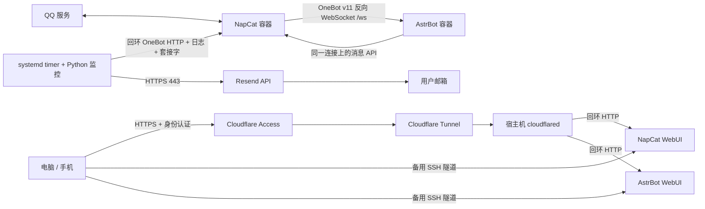

# QQBot VPS 部署流程：NapCat + AstrBot 通用部署指南

2026-10-24 Skill v2 分流：本文件保留为 NapCat 分支的详细记录；双网关共用入口为 Skill 的 `references/workflow.md`，SnowLuma 分支见 `references/snowluma.md`。Agent 必须先询问是否需要个人域名便捷登录、是否需要邮件告警，并分别确认域名/Cloudflare/DNS 权限、Resend/已验证发信域名/收件邮箱等条件。Cloudflare 与 Resend 是独立可选项；本文件第 10、11 节及对应验收只在选择后执行，未选项不阻止基础部署。

本文从三段实际部署会话及其交付源码提炼；核对日期：2026-10-03。适用于新建、重装、迁移、修复 Linux VPS。本文是通用流程，不是当前服务器的配置备份。当前 IP、域名、QQ、邮箱、Token、镜像摘要和实例目录均不收录。变量必须从目标环境检测或由用户确定。

2026-10-09 补充：第 13.1 节记录原 VPS 的“掉线后扫码提示已登录”故障、WebUI 自助恢复入口与验证边界。

## 阅读顺序与证据等级

- **历史已验证**：原 VPS 实际执行、日志或用户实收确认；不等于在新机器上已经验收。
- **通用流程**：对历史流程的参数化重用；脚本改造仅经过本地测试时会特别说明。
- **官方补充**：为新 Agent 补齐安装或控制台步骤；不冒充历史执行事实。
- **未从当前部署记录验证**：记录不足、未执行或未完成验收。
- **[USER ACTION REQUIRED]**：用户亲自认证、扫码、输入 Secret 或确认高影响变更。

目录：1 架构；2 前提与变量；3 环境检查；4 Docker；5 NapCat；6 AstrBot；7 OneBot；8 QQ；9 持久化；10 Cloudflare；11 告警；12 安全；13 踩坑；14 验收；15 恢复；16 证据与来源。

## 1. 整体架构与技术路线



NapCat 负责 QQ 客户端登录、收发及 OneBot v11 接口；AstrBot 是消息处理、模型和插件宿主；OneBot 是两者的协议，不是必须新增的第三个容器。AstrBot 提供反向 WebSocket 服务端，NapCat 是主动连接的客户端。二者在同一 Compose bridge 网络，通过服务名 `astrbot` 通信；容器里的 `127.0.0.1` 指向自己，不能拿它连另一容器。

管理面与消息面分离：WebUI 和监控 HTTP 发布到宿主机回环；OneBot WS 不发布宿主机端口。Cloudflare Tunnel 由**宿主机 systemd cloudflared**出站接通，回源这两个回环地址；不把 cloudflared 放进普通 bridge 容器后还照搬 `127.0.0.1`。

最终告警发送是 **VPS → Resend HTTPS API → 邮箱**。Cloudflare 提供 WebUI 的 DNS、HTTPS 代理、Tunnel 和 Access 身份校验；它不是这套 QQ 掉线邮件的发送器。Access 一次性登录验证码也不是掉线邮件。发信域名 DNS 可以由 Cloudflare 托管；具体历史 SPF/DKIM 设置未在三段会话中完整记录。

可选的历史附加组件：Gemini 专用 sing-box 代理是第三个容器，独立 Compose 项目、连接 Bot 网络、无宿主机端口；只配置指定模型提供商的代理，不改 NapCat 或全局出口。它不是 QQBot 部署前提，详见 Skill 的 `references/optional-provider-proxy.md`。

## 2. 部署前提与变量

历史基线是 Debian 12 / amd64、2 vCPU、2 GiB RAM、40 GiB 系统盘，加 2 GiB Swap 后完成即时验收。这是成功实例的规模，**不是最低配置保证**。先检查剩余资源；新机器建议至少预留类似资源，不在同机跑本地大模型。Debian 12 最贴近记录；Debian 13、Ubuntu、ARM 需要核对镜像架构和安装方式，未从当前部署记录验证。

必须有：可用 SSH 密钥/认证、sudo 或 root 运维权限、能正常登录的 QQ 小号和手机 QQ、DNS 与出站网络、Docker Engine + Compose v2、Python 3、curl、jq、util-linux（`nsenter`、`flock`）、iproute2、可信镜像来源。

域名对纯 SSH 管理和 QQ 消息链路不是必须；按历史路线提供固定 Cloudflare 管理入口，需要用户控制并已接入 Cloudflare 的域名、Cloudflare 账户和 Zero Trust 配置。Resend 自有发信域名还需要邮件 DNS 验证；收件邮箱需能接收邮件。模型 API 和代理仅在用户需要模型回复时配置，`/help` 基础验收不依赖模型 Key。

| 变量 | 用途 / 选取规则 |
|---|---|
| `VPS_HOST`、`SSH_USER`、`SSH_KEY_PATH`、`SSH_PORT` | 连接目标；密钥仅保留在用户本机 |
| `DEPLOY_DIR`、`COMPOSE_PROJECT_NAME` | 新建专用目录/项目；已有部署优先检测和复用 |
| `NAPCAT_IMAGE`、`ASTRBOT_IMAGE` | 检测当前版本或选择可信仓库的 `image@sha256:…`；不抄旧摘要 |
| `NAPCAT_WEBUI_PORT`、`ASTRBOT_WEBUI_PORT` | 宿主机空闲回环端口；容器默认 6099 / 6185 来自产品接口 |
| `ONEBOT_WS_PORT`、`ONEBOT_HTTP_PORT` | WS 容器内部监听；HTTP 宿主机回环探测端口 |
| `NAPCAT_CONTAINER`、`ASTRBOT_CONTAINER` | 唯一容器名称，避免和已有项目冲突 |
| `QQ_ACCOUNT` | 用户确定的 Bot 账号；ACCOUNT 只选账号，不是密码 |
| `DOMAIN`、`NAPCAT_HOSTNAME`、`ASTRBOT_HOSTNAME` | 仅域名入口：两个独立主机名，检查 DNS 冲突 |
| `CLOUDFLARE_TUNNEL_NAME`、`ACCESS_TEAM`、`ACCESS_AUD` | 仅域名入口：目标控制台产生，AUD 分别匹配应用 |
| `TUNNEL_TOKEN_FILE`、`CLOUDFLARED_BIN` | 仅域名入口：私有 Token 文件、检测到的可执行路径 |
| `MONITOR_CONFIG`、`MONITOR_STATE`、`MONITOR_UNIT` | 仅邮件告警：私有配置、持久状态、服务名 |
| `ONEBOT_TOKEN_FILE`、`RESEND_API_KEY_FILE` | HTTP Token 用于 QQ 探测；Resend Key 仅邮件告警需要，秘密值不可进资产 |
| `RESEND_FROM`、`ALERT_EMAIL` | 仅邮件告警：已验证发件人、用户收件邮箱，仅目标私有配置 |

`SKILL_DIR` 表示此次复制到目标机器的 Skill 文件夹。模板中的默认产品端口可改；未确定的实例值没有默认。别将 `.env`、配置、日志、QQ 数据或二维码提交仓库。

## 3. VPS 环境检查（只读）

先确认 SSH 主机指纹及当前连接能重新建立，再运行：

```bash
bash "$SKILL_DIR/scripts/preflight.sh" --deploy-dir "$DEPLOY_DIR"
```

脚本检测 OS、CPU 架构、RAM/Swap、磁盘/inode、Docker/Compose、运行中的容器、监听、DNS/HTTPS、系统时间、相关服务和防火墙概况；不安装、不改规则、不显示容器 Env 或配置。无权限/缺工具表示“未检查”，不表示通过。原始监听含地址，留在私有终端，不复制成公开报告。

进一步针对当前环境确认：

```bash
docker compose version
systemctl is-enabled docker
ss -lntup
df -h
df -i
free -h
swapon --show
timedatectl status
```

安全组/云防火墙是另一层，宿主机检查不能证明云侧规则；有授权 API 就只读检测，否则 **[USER ACTION REQUIRED]** 在云控制台查看。确认候选管理端口未占用、目录无已有数据、无未知 Compose 项目、无进行中的 apt 操作、磁盘和 inode 足够。

网络分开测：发行版仓库、镜像 registry、QQ 连通、Resend 443、Cloudflare DNS 与 Tunnel 出站 7844（UDP QUIC / TCP HTTP2）。仅 HTTPS 443 成功不能证明 Tunnel 可用。代理变量只报告是否设置，不打印含凭据的 URL。时间异常会影响 TLS 和登录。

## 4. Docker / Compose 准备

先给用户可回滚的变更清单。已有 Docker 不重新安装、不卸载冲突包、不改 daemon 配置；先判定是否可用。首次安装会创建桥接/NAT/转发规则，需要确认现状和授权。历史并未修改 SSH 配置或云防火墙。

新 Debian 可按官方 apt 仓库路径安装（官方补充；执行前核对发行版和既有软件）：

```bash
sudo apt-get update
sudo apt-get install -y ca-certificates curl jq python3 iproute2 util-linux
sudo install -d -m 0755 /etc/apt/keyrings
sudo curl -fsSL https://download.docker.com/linux/debian/gpg -o /etc/apt/keyrings/docker.asc
sudo chmod a+r /etc/apt/keyrings/docker.asc
```

按检测值配置仓库并安装（仅新 Debian、确认无冲突及获得安装授权后执行）：

```bash
OS_CODENAME=$(. /etc/os-release; printf '%s' "$VERSION_CODENAME")
DPKG_ARCH=$(dpkg --print-architecture)
sudo tee /etc/apt/sources.list.d/docker.sources >/dev/null <<EOF
Types: deb
URIs: https://download.docker.com/linux/debian
Suites: $OS_CODENAME
Components: stable
Architectures: $DPKG_ARCH
Signed-By: /etc/apt/keyrings/docker.asc
EOF
sudo apt-get update
sudo apt-get install -y docker-ce docker-ce-cli containerd.io docker-buildx-plugin docker-compose-plugin
docker version
docker compose version
```

仓库目标文件已存在时先检查，不能覆盖未知来源。不直接管道运行联网脚本，不擅自移除其他项目使用的 containerd。安装后验证 Engine、Compose v2 和第二条 SSH 连接，必要时经授权启用 Docker 自启动。

历史小内存机器加了 Swap；新机器先看 RAM、现有 Swap、磁盘和文件系统再规划。不得覆盖已有 swapfile，不把“必须 2 GiB Swap”当全局要求。OOM 排查和日志轮转优先于反复重启。

## 5. NapCat 部署

Skill 的 `assets/compose.yaml` 是历史成功模板的参数化版：保留 `MODE=astrbot`、三个 bind mount、`restart: unless-stopped`、日志 `10m × 3`、回环映射、内部网络。共享的 `data:/AstrBot/data` 在历史及官方组合模板都存在，勿无依据移除。

在用户选定的空目录内复制 Compose 和 `.env.example`（改名 `.env`），填写**非秘密**变量，保护文件权限；`QQ_ACCOUNT` 仍是私有账号信息，不进公开资产。创建 `data`、`ntqq`、`napcat/config` 目录，并按镜像 UID/GID 配置可写权限。历史 NapCat 容器 UID/GID 为 0；不能把它升级成“所有机器必须 root 容器”。非 root 模式需现场验证读写及启动，不用 `chmod 777` 解决。

```bash
cd "$DEPLOY_DIR"
docker compose --env-file .env -f compose.yaml config --quiet
docker compose --env-file .env -f compose.yaml pull
docker compose --env-file .env -f compose.yaml up -d
docker compose --env-file .env -f compose.yaml ps
```

可信仓库候选是官方组合模板中的 `mlikiowa/napcat-docker`、`soulter/astrbot`；根据目标架构/可达性选择并记录来源。固定目标验证过的镜像 digest；`docker inspect .Image` 是本机镜像 ID，不能自动当成 registry RepoDigest。镜像下载受阻时先测 DNS/TLS、代理和可信镜像源，不混用来源或关闭 TLS。上述命令会启动服务；修复任务只重建目标服务，先备份。配置文件首次扫码后可能才生成。

## 6. AstrBot 部署

同一 Compose 启动 AstrBot，持久化 `/AstrBot/data`；WebUI 只映射回环。通过 SSH 转发管理：

```bash
ssh -i "$SSH_KEY_PATH" -p "$SSH_PORT" \
  -o ExitOnForwardFailure=yes -o ServerAliveInterval=30 -N \
  -L "127.0.0.1:${LOCAL_NAPCAT_PORT}:127.0.0.1:${NAPCAT_WEBUI_PORT}" \
  -L "127.0.0.1:${LOCAL_ASTRBOT_PORT}:127.0.0.1:${ASTRBOT_WEBUI_PORT}" \
  "$SSH_USER@$VPS_HOST"
```

Windows PowerShell 使用已检测的 `ssh.exe` 路径；变量名沿用，保持隧道窗口。`-N` 后窗口空白是正常状态，管理命令另开终端。

**[USER ACTION REQUIRED]** 在自己的私有终端/密码管理器取得初始凭据，登录 AstrBot 并修改初始密码；NapCat WebUI Token 同样只安全填入页面，不打印到 Agent 输出。模型 Key 在 WebUI 或受保护输入里填写，不发送给 Agent；机器人权限、模型与插件由用户需要决定，不自动扩大群聊范围。

## 7. NapCat ↔ AstrBot / OneBot 配置

1. 检测组合模式生成的配置，避免重复创建适配器或覆盖账号文件。
2. AstrBot → Platforms / 平台 → OneBot v11：启用；反向 WS host=`0.0.0.0`（容器内部）、port=`ONEBOT_WS_PORT`，可配置匹配的 WS Token。
3. NapCat → OneBot 网络 → **反向 WebSocket 客户端**：启用，URL=`ws://astrbot:ONEBOT_WS_PORT/ws`，Token 与 AstrBot 一致。不要选择正向 WS 服务端替代。
4. 确认 AstrBot WS 在容器内监听；Compose 不发布此端口。按当前镜像实际 schema 配置，保留其他网络项。
5. 日志出现 `aiocqhttp(OneBot v11) 适配器已连接`，NapCat 相应连接成功；再由用户另一 QQ 发 `/help` 验证。

监控用独立 OneBot HTTP server：**容器**内监听 `0.0.0.0:3000`，**宿主机**仅 `127.0.0.1:ONEBOT_HTTP_PORT → 3000`；关闭 CORS 和额外 WebSocket，启用独立随机 HTTP Token。WS Token、HTTP Token、WebUI Token 是不同用途，不混淆。历史 `configure_monitor_http.sh` 曾覆写 httpServers 数组且重启 NapCat；通用版不复用这种无条件覆盖脚本，先备份目标账号 JSON，最小追加/修改，在需要重启前告知可能要求 QQ 再验证。

HTTP 查询 `get_status`、`get_login_info`、`nc_get_user_status`；Authorization 在 Python 内从文件读取，勿放 `curl -H "Bearer …"` 的进程参数。账号与用户确认的目标相符才通过，报告只返回匹配布尔值。

## 8. QQ 登录流程

Agent 可完成容器配置、安全入口、检查配置存在与目录权限、脱敏状态判断；不能代替手机确认 QQ 授权。

**[USER ACTION REQUIRED]** 手机 QQ 先切到 Bot 小号，核对授权账号，再扫描 NapCat 当前新二维码并完成设备/风险验证。二维码过期刷新；账号不符先停下，不能把错误账号当正确部署。只反馈成功或脱敏错误，不把二维码、Token、Cookie、密码发到聊天。

手机远程管理：Access 邮箱验证 → NapCat Token → WebUI。同一手机的二维码可尝试截图后 QQ 扫一扫相册识别；历史只确认相册入口存在，**实际同机扫码授权未从当前部署记录验证**。失败时使用第二块屏幕，不主动踢号演练。用完清理临时二维码图。

登录后同时核对 NapCat 页面、OneBot HTTP 账号、AstrBot 连接及用户 `/help` 回复。WS 心跳只能维护这一段连接，不能保证 QQ 永不失效；不以定时发消息或无限重启来保号。

## 9. 数据持久化与自启动

| 宿主机相对目录 | 容器路径 | 内容 |
|---|---|---|
| `$DEPLOY_DIR/data` | `/AstrBot/data` | AstrBot 配置、模型凭据、插件和业务数据 |
| `$DEPLOY_DIR/napcat/config` | `/app/napcat/config` | NapCat WebUI / OneBot 配置 |
| `$DEPLOY_DIR/ntqq` | `/app/.config/QQ` | QQ 客户端数据与登录态 |

这是 bind mount，不是匿名 volume。验证实际 Mounts 和读写权限，不只看 Compose 文本。监控配置/Key 与状态、cloudflared Token 在各自私有目录；部署备份也含 Secret，需限制权限和安全传输。

`restart: unless-stopped` + Docker 自启动恢复容器；主动停止的容器可能仍保持停止，需要明确启动。timer 和 cloudflared 分别启用 systemd。历史授权重启后 Docker、两个容器、Swap、timer 自动恢复；但 QQ 登录态失效，需要扫码。Tunnel 是之后添加的，**带 Tunnel 的整机重启验收未从当前部署记录验证**。

## 10. 可选：Cloudflare 远程管理

仅用户明确选择域名便捷登录或要求修复已有入口时执行。先确认域名所有权、Cloudflare 账号、DNS 权限、主机名与 Access 身份；未选择时跳过 cloudflared 安装、Token、DNS、Access 和对应验收，继续 SSH 管理。不因选择了本节就自动选择邮件。

此处给出完整路线；配置和排错细节见 Skill 的 `references/cloudflare.md`。

1. **[USER ACTION REQUIRED]** Cloudflare 托管域名、启用 Zero Trust 的 OTP 或已有可信 IdP，确认两个主机名没有其他服务占用。
2. **先建 Access、后发布路由**。各建一条精确主机名的 Self-hosted 应用，覆盖整个站点，Allow 仅指定用户邮箱；不设 Everyone / Bypass。用户在控制台输入邮箱、验证码。
3. 在 VPS 安装检测架构匹配的 cloudflared，确定 `CLOUDFLARED_BIN`。一个远程管理 Tunnel 对应两个管理入口。
4. **[USER ACTION REQUIRED]** 控制台创建 Tunnel，复制 connector Token 到自己的受保护输入，别把完整安装命令交给 Agent。先不加公开路由。
5. Token 经 SSH 标准输入/用户私有终端存入 `TUNNEL_TOKEN_FILE`，目录 700、root 文件 600。服务使用 `DynamicUser` + `LoadCredential` + `--token-file`；资产模板需替换检测出的路径，不把 Token 写进 ExecStart、环境、命令行。
6. 服务启动并检查注册连接；历史有 4 条注册连接，这是观测结果，不要求每个目标必须恰好 4 条。
7. **[USER ACTION REQUIRED]** 添加 NapCat 主机名 → `http://127.0.0.1:NAPCAT_WEBUI_PORT`；启用 **Protect with Access**，选择对应应用/AUD。先验证匿名访问被挡，再添加 AstrBot 对应路由和应用。
8. 桌面无痕和手机移动网络分别访问两个入口：未登录只能 Access 登录/拒绝，登录后才看到正确 WebUI；保留应用本身的 Token/密码。HTTP 302 本身不是 Access 验收，要确认跳转到 Access 而非 WebUI 自己的登录页。

不直接开放管理端口：这样减少绕过身份代理、弱密码探测和 Docker 端口发布造成的暴露。Tunnel 不需要新增入站 80/443，但需要出站 7844 及所需 443。Cloudflare 会代理并终止 HTTPS，能处理管理流量。保留 SSH 作为 Tunnel 故障时的备用，不删除 SSH 通道。

## 11. 可选：告警系统

仅用户明确选择邮件告警或要求修复已有告警时执行。先确认 Resend 账号、发信域名及验证 DNS 的条件、发件人、收件邮箱和 Key 私密录入方式。此选项独立于 WebUI 域名入口；没有 Cloudflare 也可通过其他 DNS 服务商验证发信域名。未选择时不安装/启用邮件 timer，不要求邮件实收。

历史最终成功的是 Resend-only，ntfy 已从活动链路移除，旧文件仅在私有备份。ECS RAM Role / 云监控、SWAS→FC 曾讨论或产生草案，**未部署验收，不是最终路线**。

### 11.1 检测、状态与限制

systemd timer：`OnBootSec=2min` + `OnUnitActiveSec=2min`，不叠加日历触发。Python 综合新 NapCat 登录日志、OneBot HTTP `online/good`、登录账号一致性、可选主动状态查询，并观测 AstrBot WS 连接。

- 连续 3 次明确 offline → `QQ_LOGIN_LOST`；持续离线只入队一次。
- 连续 2 次 online → `QQ_LOGIN_RESTORED`；初次从 unknown 在线不发恢复事件。
- 恢复后 30 分钟内再次离线会冷却；冷却期间已恢复可撤销未发掉线事件，不机械承诺固定 6 分钟送达。
- unknown 清零连续计数，不等同 offline；发信失败入持久队列，按顺序重试，最高约 30 分钟间隔。
- 登录失效日志会锁存离线，直到新登录成功日志清除。曾补充 `OneBot11 适配器初始化完成` 以识别恢复。

**真实覆盖边界**：只有 OneBot 断连而 QQ 在线时，历史 probe 返回 online 并注明连接不可用；持续 unknown、整机宕机、timer 本身停运没有独立邮件告警。代码也没有跨网络的“恰好一次送达”保证：服务端已接受但响应丢失时重试可能重复。不要把模拟去重成功说成所有失败下绝无重复。若用户需要这些覆盖，另行提出外部心跳/独立故障事件设计，不悄悄重写可靠状态机。

### 11.2 配置发信

**[USER ACTION REQUIRED]** 在 Resend 验证自己的发信域名、按面板提供值配置 DNS 并等待通过；生成仅发送权限、限定域名的 Key（若当前服务支持）。在 Cloudflare DNS 填 TXT/MX 等验证记录，值按 Resend 面板，不能复制旧实例。历史邮件实收证明当时可发送，具体 DNS 创建过程**未从当前部署记录验证**，该前置操作为官方补充。

复制 `assets/monitor-config.example.json` 到 `MONITOR_CONFIG` 并替换目标 HTTP URL、Token 路径、已确认 QQ、容器名、WS 端口、Key 路径、发件人和收件人。生成 HTTP Secret 和用户录入 Resend Key 时用非回显输入/安全文件传输；文件 root 600、父目录 700，拒绝写进模板或 Git。

部署 `scripts/qq_monitor.py` 到 `$DEPLOY_DIR/bin`；systemd service 设置 `QQBOT_MONITOR_CONFIG` / `QQBOT_MONITOR_STATE` 的路径，flock 防重入。模板逐项替换后用 `systemd-analyze verify` 检查，先手动测试再经授权启用 timer。历史监控需 root 读 Docker 日志和 nsenter；cloudflared 动态用户不具备这权限，两者不可随意合并。Docker 组近似 root 权限，不授给无关用户。

本次参数化监控保留历史探测、阈值、冷却和重试，新增路径/容器/端口/发件人变量及错误信息脱敏。独立审查后还修正日志 stdout/stderr 时序（统一收集并按时间排序），每轮最多发送一个队列事件，去掉同轮重复 WS 探测，将 service 超时预算从历史 50 秒改成 180 秒。这些属于本次通用化改造；nc_get_user_status 只验证调用成功，未解读返回状态，不能单独证明 QQ 在线；**仅本地离线测试验证，未部署到新 VPS**。

```bash
export QQBOT_MONITOR_CONFIG="$MONITOR_CONFIG"
export QQBOT_MONITOR_STATE="$MONITOR_STATE"
python3 "$DEPLOY_DIR/bin/qq_monitor.py" --test-resend
```

### 11.3 真正验收

先发送标明测试的邮件：API 返回 mail ID **并且用户邮箱实收**才通过。测试模式不读写真实状态、不改 QQ。

状态机本地隔离测试：`python3 "$SKILL_DIR/scripts/test_monitor.py"`，无真实发信。历史还进行过 7 次模拟离线、实际只收到 1 封模拟告警。新目标若做端到端模拟，用独立临时状态、清晰标识模拟，不覆盖生产状态、不主动踢号；发送前属于用户授权的测试范围，数量应明确。

历史真实掉线/恢复的 ntfy 实收和后来 Resend 测试/模拟实收是两次不同验收；**切换 Resend 后自然掉线恢复的完整实收未从当前部署记录验证**。新部署须记录实际验收等级。检查 timer enabled/active、service Result、最近探测时间及 pending；`phase=online` 的旧状态文件不能证明此刻在线。

## 12. 安全与高影响操作

- 管理 WebUI / OneBot HTTP 不应公网发布，WS 仅内网；检查 IPv4、IPv6、Docker PortBindings 和云侧规则。不能只因 UFW deny 或 ss 未见监听就宣称安全。
- Docker 会自动建立转发与 NAT，发布端口可能绕过常规 UFW 路径；首次安装/网络变更前检查规则和其他服务，不清空规则，不关闭 Docker 防火墙管理图省事。
- Access 保护和 WebUI 身份校验同时保留；精确域名、整个站点、匹配 AUD。匿名直达 WebUI 时先撤下该路由或修好保护，不裸露排错。
- Secret 不写聊天、仓库、截图、命令参数或普通日志；原始配置、启动日志可能含初始密码，先脱敏。含登录态的备份也按 Secret 管理。
- 不擅自重启整机、调整 SSH、改防火墙/公网暴露、删除数据；说明具体影响并在动作前获取对应授权，不能继承旧 VPS 的授权。第二条 SSH 会话与回滚路径先准备。
- 先检查已有服务，只修目标组件；不执行 `down -v`、`prune`、无差别删卷或 `--remove-orphans`。升级和重启可能触发手机验证，先安排用户可操作的窗口。

## 13. 实际踩坑速查

一般故障的详细排查见 `astrbot-napcat-vps/references/troubleshooting.md`；掉线后扫码提示已登录的现场记录集中在本文第 13.1 节。历史问题包含：

1. SWAS 被误当 ECS，ECS 角色绑定路线不适用；最后没有部署该云告警路线。
2. SSH `-N` 空白被当作失败、电脑隧道断开被当成服务器故障。
3. 容器/系统恢复后 QQ 登录态仍失效；持久化不是永久免扫码。
4. `get_status online=true` 与真实离线冲突；需日志锁存、账号和多信号。
5. 恢复日志正则未覆盖 OneBot 初始化完成；修正规则后恢复状态识别。
6. 手机误用其他 QQ 账号扫码；须核对目标账号再授权。
7. ntfy Topic 截图泄露；轮换后旧值作废，不复用截图传密钥。
8. Python 请求 Resend 403 / 1010、curl 能连通；加入明确 User-Agent 后成功。
9. 代理镜像下载、Mihomo Hysteria2 跳跃端口格式差异、Compose 孤儿容器风险。
10. Cloudflare 控制台入口变化和手机 Token 转移；先保护再路由，临时 Token 二维码最后删除。
11. 掉线后扫码提示“当前账号已登录，无法重复登录”，实际消息无回复；按第 13.1 节重建 NapCat 登录进程，再扫码验收。

### 13.1 掉线后扫码提示“已登录”，但实际无法收发

**匿名化故障样本（NapCat 4.18.28）**：日志先报告账号离线，随后重新扫码反复提示“当前账号已登录，无法重复登录”，但实际消息无回复。经授权仅重启 NapCat、重新扫码后，出现 `OneBot11 适配器初始化完成`，只读探测与真实回复均恢复。另一类重登故障可能伴随 QQ 风控错误码 168，不能把所有失败都归为同一个原因。

**代码检查结论**：当时运行代码中的两条掉线路径处理不一致：

- `onSelfStatusChanged(status=20)` 仅设置 `selfInfo.online=false` 并记录离线，没有同步重建 QQ 登录服务。
- `KickedOffLine` 事件路径才会清理 WebUI 登录状态并请求重启 Worker；本次日志只观察到前一种离线路径。
- “当前账号已登录，无法重复登录”由 QQ 登录服务的 `onUserLoggedIn` 回调产生，不是实际收发成功的证明。结合扫码失败、重启后恢复，推断旧 QQ 登录会话未正确释放或重建；未直接验证 QQ 内核内部状态。

因此，重复刷新二维码或只改 WebUI 的已登录标志，不足以恢复卡住的底层会话。两个 WebUI 正常、OneBot 连接存在、单次 `get_status online=true` 也不能代替 QQ 实际消息验收。

**WebUI 自助恢复（优先）**：

1. 打开自己的 NapCat 管理入口，通过 Access（若启用）和 WebUI Token 认证。
2. 若在二维码登录页：点右上角齿轮 → **设备 GUID 管理 → 重启 NapCat**。
3. 若仍能进入控制台：**系统配置 → 登录配置 → 进程管理 → 重启进程**。
4. 确认重启，等待约 10～30 秒，再刷新页面；需要登录时，确认手机 QQ 是目标 Bot 小号，扫码新二维码并完成授权。
5. 从另一个 QQ 号私聊发送 `/help` 和一句普通文本，分别确认命令回复与模型聊天回复；同时核对目标账号、新登录日志和 AstrBot OneBot 连接。

只使用上述重启按钮，**无需修改 GUID、MAC、machine-id 或重置设备标识**。重启 Worker 会短暂中断 QQ/OneBot，可能要求重新扫码；此操作不等同于重启整台 VPS 或 AstrBot。

**验证边界**：上述两个 WebUI 入口、后端重启回调及运行中的 Worker 模式已通过现场代码和进程检查确认；为保留刚恢复的在线会话，本次未点击 WebUI 重启按钮做端到端演练。实际验证成功的是“SSH 重启 NapCat 容器 → 用户扫码 → 现场探测在线及 OneBot 连接 → 用户确认重连”。未来版本的菜单和进程模式可能变化，应重新核对。

**WebUI 重启失败时的备用方法**：在自己的 SSH 终端，仅重启已确认名称的 NapCat 容器。执行前安排好手机验证窗口；不要重启整个 Compose 项目。

```bash
docker restart --timeout 20 "$NAPCAT_CONTAINER"
```

若扫码返回 QQ 错误码 **168**，并提示账号安全风险、部分功能受限，先在最新手机 QQ 登录目标小号，按提示恢复账号使用，再扫码；重启不能解除服务端风控，不反复重启或连续扫码。

**长期修复方向（未实施）**：补齐普通离线事件的登录服务恢复处理，区分临时断网与登录失效，加入防重入、冷却和重试上限；恢复后继续依赖账号核对和实际消息验收。不能只把 `online` 强制改成 `true`，也不能承诺免扫码或绕过风控。

上游同症状记录：[NapCatQQ #2027：QQ 被踢下线后无法再次登录](https://github.com/NapNeko/NapCatQQ/issues/2027)。该 Issue 报告的是 4.18.19；只能作为相同现象的佐证，不证明当前运行版本已修复。

## 14. 部署完成验证 Checklist

自动检查 `scripts/verify.py` 只读，无真实发信、不改状态；需显式参数，退出码 0=脚本覆盖通过，1=失败，2=证据不足。它不替代下表用户验收。检测值确定后执行：

```bash
python3 "$SKILL_DIR/scripts/verify.py" \
  --napcat "$NAPCAT_CONTAINER" --astrbot "$ASTRBOT_CONTAINER" \
  --napcat-webui-port "$NAPCAT_WEBUI_PORT" \
  --astrbot-webui-port "$ASTRBOT_WEBUI_PORT" \
  --onebot-http-port "$ONEBOT_HTTP_PORT" --onebot-ws-port "$ONEBOT_WS_PORT"
```

仅选择 Tunnel 时追加 `--cloudflared-unit "$CLOUDFLARED_UNIT"`；仅选择邮件时追加 `--monitor-config "$MONITOR_CONFIG" --monitor-state "$MONITOR_STATE" --monitor-unit "$MONITOR_UNIT"`。仅 QQ 探测可用 `--qq-probe-config` 指定 HTTP URL、Token 路径、目标账号、网关类型/容器名和 WS 端口，不需要邮箱或 Resend Key。未选 QQ probe 时退出 0 不代表真实消息实收。历史没有后续 24 小时实测报告，持续稳定 24 小时未验收。

- [ ] Compose quiet 校验通过，两个容器 running，无 OOM / 非预期重启。
- [ ] 镜像来源与 registry digest 记录在目标私有报告，数据 Mounts 和权限正确。
- [ ] WebUI / HTTP PortBindings 仅回环，WS 无宿主机发布；IPv4/IPv6/云规则检查。
- [ ] NapCat 登录目标账号；HTTP online/good、账号一致；新日志无未恢复登录失效。
- [ ] AstrBot 反向 WS 确认建立；**[USER ACTION REQUIRED]** 另一 QQ `/help` 实际收到回复。
- [ ] 本机 HTTP 响应与备用 SSH 隧道都可用。
- [ ] 仅选择域名时：匿名访问到 Access、回源 JWT/AUD 匹配；**[USER ACTION REQUIRED]** 用户认证后对应 WebUI 可用，设备范围按实际需求验收。
- [ ] Docker 自启动；仅选择相应可选项时检查 timer/cloudflared 自启动。重启演练须单独授权，不假定免扫码。
- [ ] 仅选择邮件时：测试邮件 API 接受且用户实收、隔离模拟去重；自然掉线恢复标记实测或待测。
- [ ] 仅选择邮件时：timer active/enabled、最近探测新鲜、pending 正常；unknown 不标通过。
- [ ] 系统内存、Swap、磁盘、日志轮转、24 小时观察；已跑脚本与稳定运行 24 小时区分记录。
- [ ] Secret 和备份权限正确，无凭据进入仓库，存在恢复路径。

最终报告逐项写“通过 / 失败 / 待用户 / 未验证”，未选择的域名/邮件写“不适用”，不列为缺失故障；脚本通过不得冒充生产全部验收。

## 15. VPS 迁移 / 重装恢复

通用恢复流程；**跨 VPS 完整迁移演练未从当前部署记录验证**。

1. 只读盘点 Compose、镜像 RepoDigests、Mounts、私有配置、监控服务/状态、Tunnel、可选代理。对数据和私有目录做一致性备份；需要暂停服务保证一致性时先安排停机，不盲目拷贝正在写的数据库。
2. 备份 `data`、`ntqq`、`napcat/config`、Compose/非公开 `.env`、监控配置和 Token/Key、状态、systemd unit；可选代理单独备份。加密或受限传输，验证归档可读、完整性和权限；备份不要放通用 Skill。
3. 新机运行 preflight，安装适配环境，在新 `DEPLOY_DIR` 恢复 bind mounts 并保持容器目标路径；检查 UID/GID。新路径不能靠旧目录假设填入。
4. 用记录的可信镜像或经过新验证的版本启动；监控先禁用，检查日志、正确账号和 `/help`；需要手机验证就停在用户操作。
5. 仅保留用户选择的可选设施：选择域名才恢复 cloudflared/LoadCredential；同一 Tunnel 多 connector 需计划切流。选择邮件才迁移监控并在迁移窗口停旧监控避免重复邮件；不为未选择项创建新凭据或服务。
6. 迁移的监控队列可能含旧事件，检查后决定保留/归档/初始化，不能直接 flush 造成历史告警风暴。保留冷却信息的决策写进报告。
7. 验收新机全部链路，再切 DNS/路由；保留旧机回滚窗口，得到删除授权后才清理。绝不把登录态跨机器可用当保证。

## 16. 公开来源与适用边界

本文保留匿名化部署经验与明确的验证边界，不包含原始会话链接、聊天标识、用户实例配置或运行日志。它不依赖私人聊天记录、仓库之外的历史文件或某个搜索插件；部署时使用可用的工具核对当前官方文档。

公开来源说明产品操作方式，不代表新目标已完成生产验收：

- [NapCat 官方组合 Compose](https://github.com/NapNeko/NapCat-Docker/blob/main/compose/astrbot.yml)
- [AstrBot OneBot v11](https://docs.astrbot.app/en/platform/aiocqhttp.html)
- [Docker Debian 安装及防火墙限制](https://docs.docker.com/engine/install/debian/)
- [Cloudflare 创建远程管理 Tunnel](https://developers.cloudflare.com/cloudflare-one/networks/connectors/cloudflare-tunnel/get-started/create-remote-tunnel/)
- [Cloudflare Tunnel 出站网络](https://developers.cloudflare.com/cloudflare-one/networks/connectors/cloudflare-tunnel/configure-tunnels/tunnel-with-firewall/)
- [Resend 发信域名验证](https://resend.com/docs/dashboard/domains/introduction)

本指南随 Skill 一起分发；使用整个 Skill 文件夹中的入口、参考和资产即可，不要求访问作者的本机工程或私有部署记录。
